<div align="center">

# QUẢN LÝ CÁN BỘ, CHIẾN SĨ (CBCS)

**Ứng dụng desktop quản lý hồ sơ nhân sự và công tác**

Ứng dụng Windows Forms xây dựng bằng C# nhằm hỗ trợ lưu trữ, tra cứu và quản lý thông tin cán bộ, chiến sĩ; theo dõi công tác, phân công nhân sự và hỗ trợ thống kê, báo cáo.

</div>

---

## 📌 Giới thiệu

**Quản lý CBCS** là phần mềm desktop hướng đến việc tập trung hóa thông tin nhân sự và hoạt động công tác trong một giao diện thống nhất. Giao diện được tổ chức theo các nhóm chức năng: hồ sơ CBCS, công tác và phân công, lịch sử/thống kê, tài khoản và phân quyền, quản trị hệ thống, thông báo và báo cáo.

> Các ảnh dưới đây minh họa giao diện thiết kế của ứng dụng. Tính năng thực tế có thể phụ thuộc vào cấu hình cơ sở dữ liệu, tài khoản đăng nhập và phiên bản đang triển khai.

## ✨ Chức năng chính

- **Quản lý hồ sơ CBCS:** xem danh sách, tìm kiếm và thao tác quản lý hồ sơ.
- **Quản lý công tác:** tạo/cập nhật thông tin công tác, loại công tác, địa điểm, thời gian, mức độ ưu tiên và mô tả.
- **Phân công CBCS:** phân công nhân sự vào công tác và theo dõi danh sách đã/chưa phân công.
- **Lịch sử và thống kê công tác:** xem lịch sử tham gia, tổng hợp số lượt công tác và xuất dữ liệu khi chức năng được cấu hình.
- **Quản lý tài khoản:** tạo/cập nhật tài khoản, đổi mật khẩu và quản lý quyền truy cập theo vai trò.
- **Khu vực quản trị:** tổng quan số liệu, nhật ký hệ thống, trung tâm thông báo và màn hình báo cáo.

## 🖥️ Ảnh giao diện

Ảnh được lưu trong thư mục [`assets/`](assets/). Các ảnh sử dụng bố cục **hai cột** và đặt chiều rộng cố định để GitHub hiển thị cân đối hơn. Trên màn hình nhỏ, bảng có thể tự co theo vùng hiển thị.

### Khởi động và đăng nhập

<table>
  <tr>
    <td align="center" width="50%"><strong>Khởi tạo hệ thống</strong><br>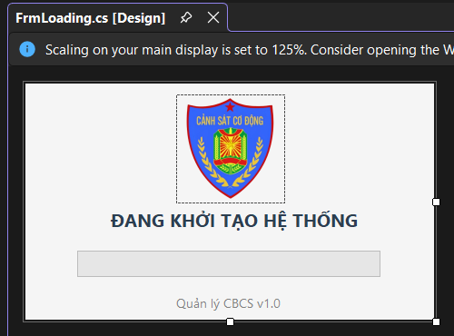</td>
    <td align="center" width="50%"><strong>Đăng nhập</strong><br>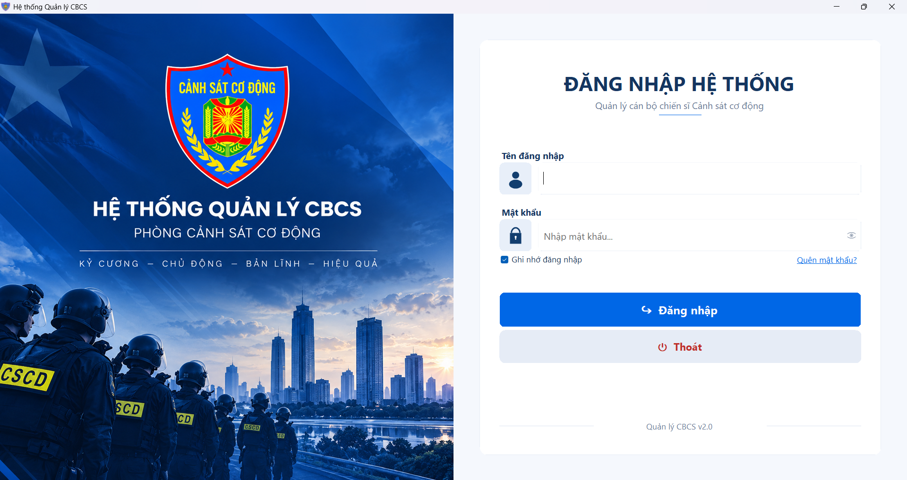</td>
  </tr>
</table>

### Hồ sơ CBCS và quản lý công tác

<table>
  <tr>
    <td align="center" width="50%"><strong>Danh sách hồ sơ CBCS</strong><br>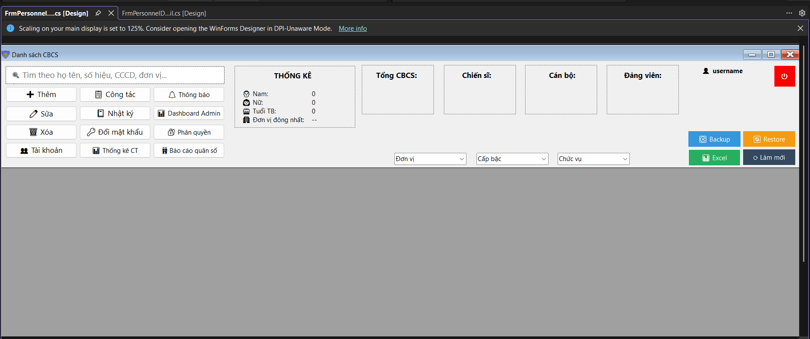</td>
    <td align="center" width="50%"><strong>Thông tin công tác</strong><br>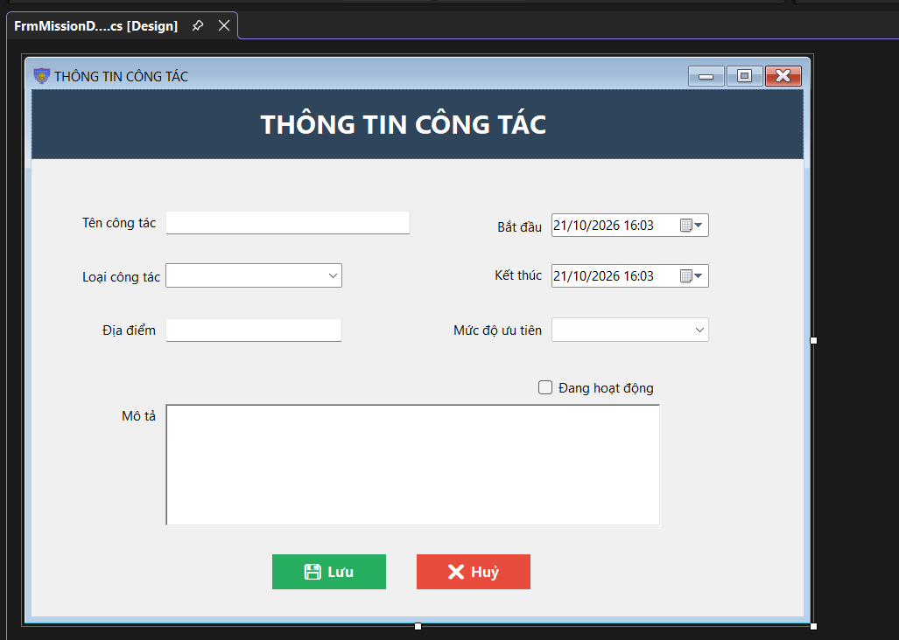</td>
  </tr>
  <tr>
    <td align="center" width="50%"><strong>Phân công CBCS</strong><br>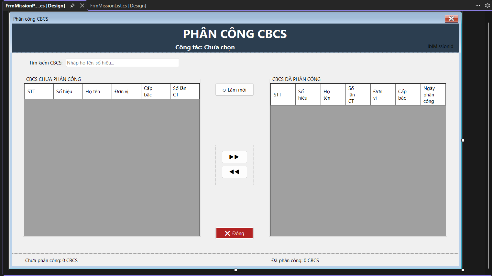</td>
    <td align="center" width="50%"><strong>Lịch sử công tác</strong><br>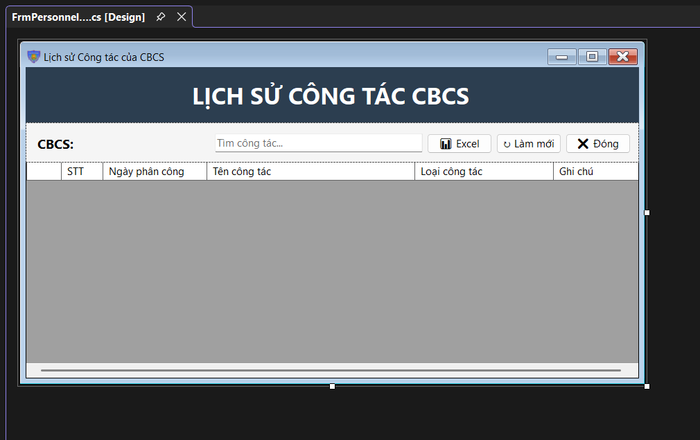</td>
  </tr>
  <tr>
    <td align="center" width="50%"><strong>Thống kê công tác</strong><br>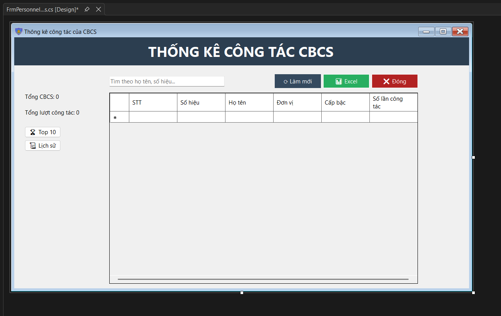</td>
    <td align="center" width="50%"><strong>Dashboard công tác</strong><br>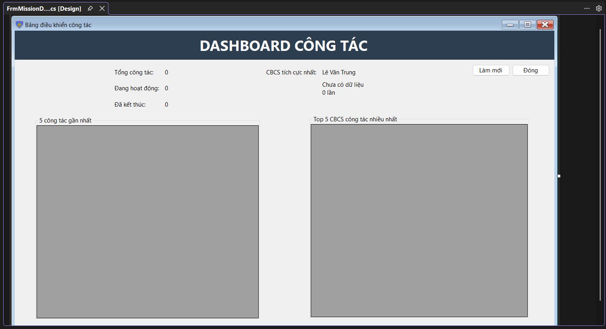</td>
  </tr>
  <tr>
    <td align="center" width="50%"><strong>Thống kê hồ sơ / báo cáo</strong><br>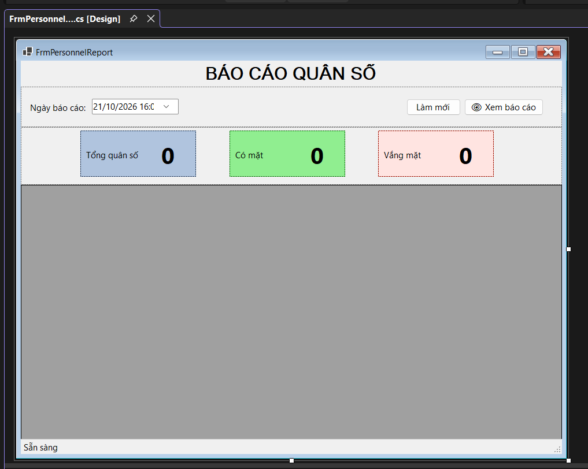</td>
    <td align="center" width="50%"><strong>Màn hình xem báo cáo</strong><br>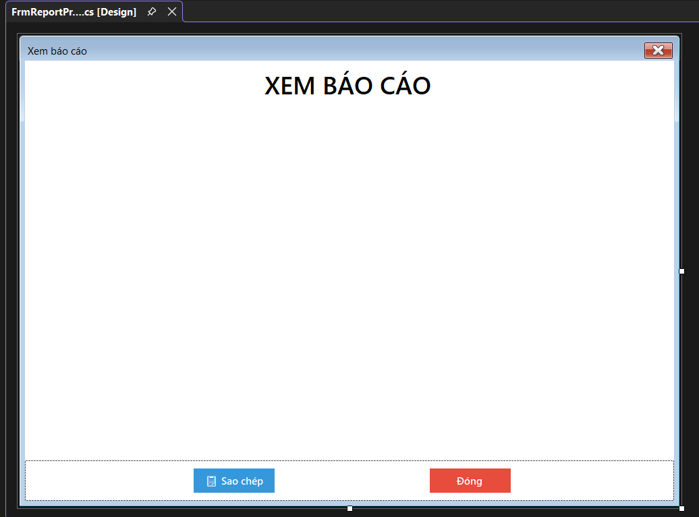</td>
  </tr>
</table>

### Tài khoản, phân quyền và quản trị

<table>
  <tr>
    <td align="center" width="50%"><strong>Danh sách tài khoản</strong><br>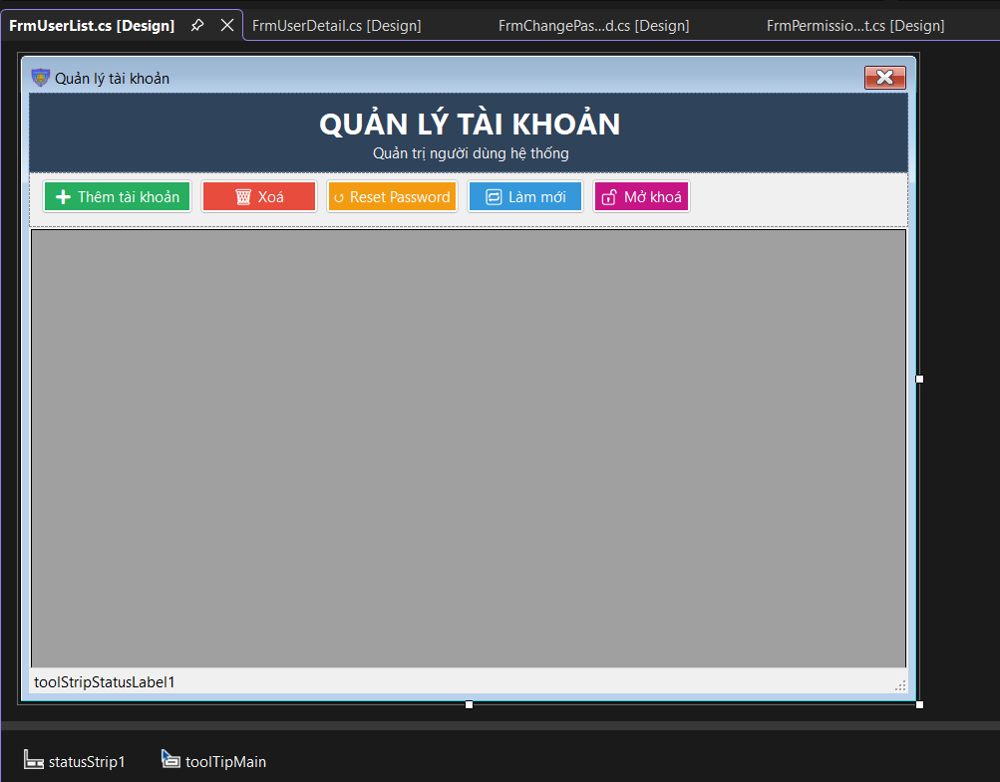</td>
    <td align="center" width="50%"><strong>Thông tin tài khoản</strong><br>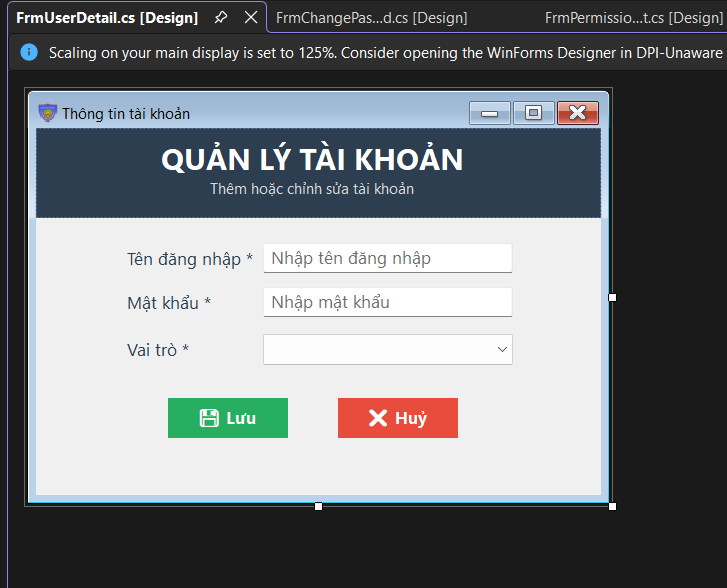</td>
  </tr>
  <tr>
    <td align="center" width="50%"><strong>Đổi mật khẩu</strong><br>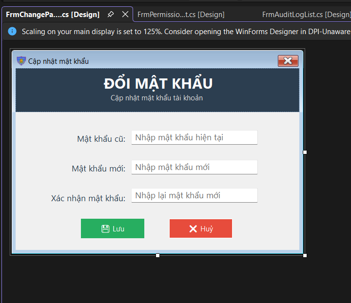</td>
    <td align="center" width="50%"><strong>Quản lý phân quyền</strong><br>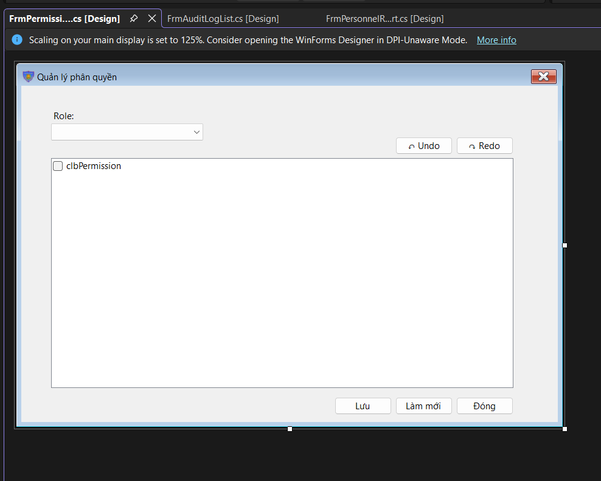</td>
  </tr>
  <tr>
    <td align="center" width="50%"><strong>Bảng điều khiển quản trị</strong><br>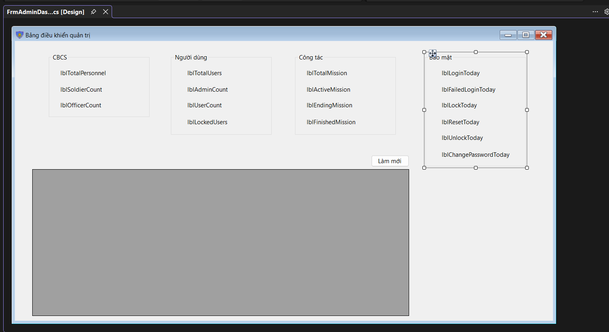</td>
    <td align="center" width="50%"><strong>Nhật ký hệ thống</strong><br>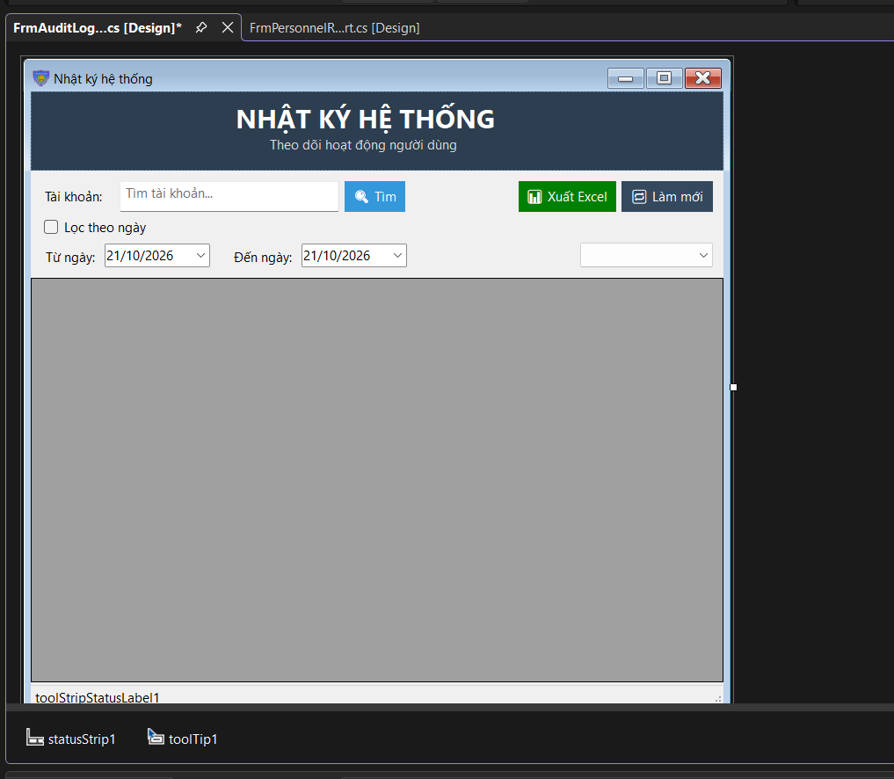</td>
  </tr>
  <tr>
    <td align="center" width="50%"><strong>Trung tâm thông báo</strong><br>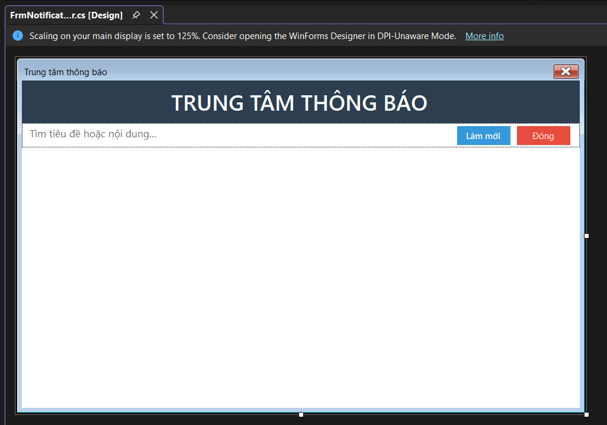</td>
    <td align="center" width="50%"><strong>Màn hình quản lý tài khoản</strong><br></td>
  </tr>
</table>

## 🧰 Công nghệ

Dựa trên cấu hình và mã nguồn của dự án, các công nghệ sử dụng gồm:

- **Ngôn ngữ:** C#
- **Giao diện desktop:** Windows Forms (WinForms)
- **Nền tảng mục tiêu:** .NET Framework 4.8 *(hãy xác nhận lại trong Project Properties nếu đã đổi target framework)*
- **Cơ sở dữ liệu:** Microsoft SQL Server
- **Môi trường phát triển:** Visual Studio

## ⚙️ Yêu cầu triển khai

- Máy tính Windows tương thích với phiên bản .NET mục tiêu của ứng dụng.
- SQL Server Database Engine đã được cài đặt và đang hoạt động.
- Cơ sở dữ liệu của ứng dụng đã được khôi phục/tạo và chuỗi kết nối trong cấu hình được cập nhật chính xác.
- Tài khoản đăng nhập hợp lệ đã được thiết lập trong cơ sở dữ liệu.

> **Lưu ý bảo mật:** Không đưa mật khẩu SQL Server, mật khẩu tài khoản, chuỗi kết nối chứa thông tin nhạy cảm hoặc bản sao dữ liệu CBCS thật lên GitHub. Nếu dự án dùng `App.config`, hãy kiểm tra và loại bỏ thông tin bí mật trước khi public repository.

## 🚀 Build và chạy

1. Mở solution bằng Visual Studio.
2. Kiểm tra `Target Framework`, các package và chuỗi kết nối trong cấu hình.
3. Chọn cấu hình `Release`, sau đó chạy **Build → Rebuild Solution**.
4. Đảm bảo SQL Server và cơ sở dữ liệu đã sẵn sàng.
5. Chạy ứng dụng từ Visual Studio hoặc sử dụng bản publish đã được tạo.

Các bước trên là hướng dẫn tổng quát; đường dẫn publish và cấu hình kết nối phụ thuộc vào thiết lập hiện tại của solution.

## 🗂️ Thư mục ảnh

```text
assets/
├── admin-dashboard.png
├── audit-log.png
├── change-password.png
├── loading.png
├── login.png
├── mission-assignment.png
├── mission-dashboard.png
├── mission-detail.png
├── mission-list.png
├── notifications.png
├── permissions.png
├── personnel-list.png
├── personnel-mission-history.png
├── personnel-mission-statistics.png
├── personnel-report.png
├── report-viewer.png
├── user-detail.png
└── user-list.png
```

## 📍 Trạng thái dự án

README này mô tả các nhóm chức năng thể hiện trên giao diện đã cung cấp. Trước khi phát hành chính thức, nên kiểm thử từng chức năng với cơ sở dữ liệu thực tế, xác minh phân quyền theo vai trò, kiểm tra sao lưu/khôi phục và xác nhận các màn hình báo cáo xuất ra dữ liệu đúng.

---

<div align="center">

**Quản lý CBCS — Desktop Application**

</div>
